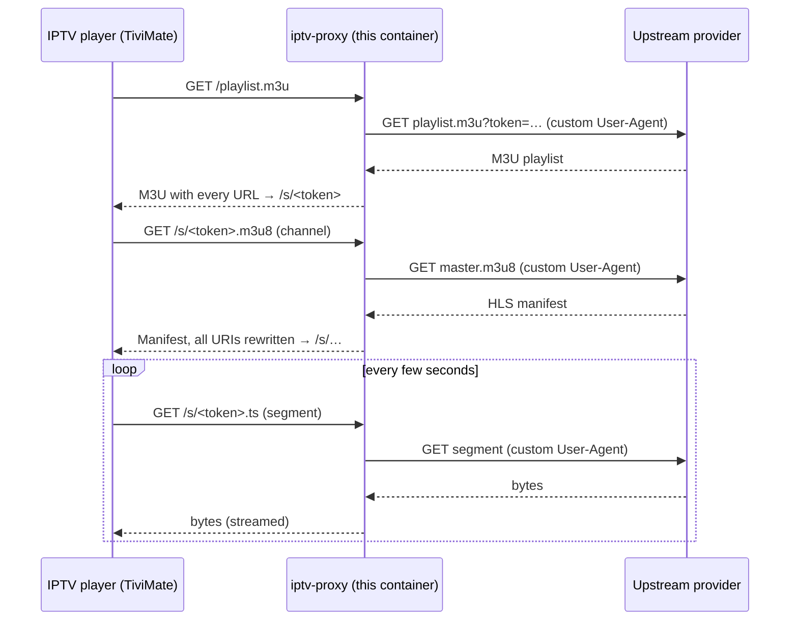

<div align="center">

# 📺 OnDemand IPTV HLS Playlist Proxy

**A tiny Docker container that turns an upstream M3U playlist into a self-hosted, always-fresh, HLS-proxied playlist for TiviMate and other IPTV players.**


</div>

---

## Why this exists

Some IPTV providers publish a playlist that only works when requested with a specific `User-Agent`, or whose stream, manifest and segment requests all need that same header. Players like TiviMate don't let you set that per request, so the playlist loads but nothing plays (or the playlist itself returns an error). This imitates the iOS app [Ondemand IPTV](https://apps.apple.com/us/app/ondemand-iptv/id6792238106) particularly.

This proxy sits between your player and the provider:

1. It fetches the upstream playlist **with the required User-Agent**.
2. It **rewrites every stream URL** so it points back at the container.
3. It **proxies the streams themselves**, rewriting HLS manifests on the fly so variant playlists, segments, encryption keys and audio tracks all flow through the proxy too.

Your player only ever talks to your own server, and the playlist stays dynamic: every refresh reflects what the provider currently publishes.

## Features

- 🔄 **Dynamic playlist.** Fetched from upstream on demand, cached briefly (default 60 s), and served **stale if the upstream is down** so your channel list doesn't vanish.
- 🧬 **Full HLS rewriting.** Master playlists, variant playlists, `#EXT-X-KEY`, `#EXT-X-MAP`, `#EXT-X-MEDIA` and other `URI="..."` attributes are all rewritten, and relative URLs are resolved against the final (post-redirect) upstream URL.
- 🎭 **Custom User-Agent** on every upstream request: playlist, manifests, segments and keys.
- 📡 **Streams pass-through.** Segments and raw `.ts` / progressive streams are streamed chunk by chunk, with `Range` support and no buffering in memory.
- 🔍 **Content sniffing.** HLS manifests are detected by content (`#EXTM3U`), not just file extension, so extension-less URLs work.
- 🏷️ **Extension hints.** Proxied URLs keep `.m3u8` / `.ts` / `.m4s` suffixes so players pick the right demuxer.
- 🔐 **Optional access key** (`?k=...`) to protect the proxy if it's reachable beyond your LAN.
- 🪶 **Small and fast.** Single async Python process (`aiohttp`), non-root container, built-in healthcheck.
- 🌐 **Zero-config base URL.** Links are built from the `Host` header of each request, so `http://<lan-ip>:8080` just works.

## How it works



Upstream URLs are encoded as URL-safe Base64 inside the proxied path (`/s/aHR0cDovL…​.m3u8`). The proxy is **stateless**: nothing is stored on disk and restarting the container doesn't break links that players already have cached.

## Quick start

**Requirements:** Docker with the Compose plugin.

```bash
git clone https://github.com/<you>/<repo>.git
cd <repo>

cp .env.example .env
# edit .env and set UPSTREAM_PLAYLIST_URL (the full URL, token included)

docker compose up -d --build
```

Check that it's alive:

```bash
curl http://localhost:8080/healthz          # → ok
curl http://localhost:8080/playlist.m3u | head
```

Follow the logs:

```bash
docker compose logs -f
```

## Using it with TiviMate

1. In TiviMate, go to **Add playlist → M3U playlist**.
2. Enter the playlist URL of the machine running the container:

   ```
   http://<docker-host-lan-ip>:8080/playlist.m3u
   ```

   If you enabled an access key, use `http://<docker-host-lan-ip>:8080/playlist.m3u?k=<ACCESS_KEY>`.
3. Finish the wizard and let TiviMate load the channels.

The same URL works in any M3U-capable player (VLC, IPTVnator, Kodi's IPTV Simple Client, and so on).

> **Tip:** TiviMate re-downloads the playlist on its own update schedule, so channel changes from your provider show up automatically. Lower `PLAYLIST_TTL` if you want upstream changes picked up faster.

## Configuration

All configuration is done through environment variables (the Compose file reads them from `.env`).

| Variable | Required | Default | Description |
|---|:---:|---|---|
| `UPSTREAM_PLAYLIST_URL` | ✅ | n/a | Full URL of the upstream M3U playlist, including any token. |
| `USER_AGENT` | | `Mozilla/5.0 OnDemandIPTV AppleWebKit/605.1.15 (KHTML, like Gecko) Version/17.5 Safari/604.1` | User-Agent sent on **every** upstream request. Don't wrap it in quotes in `.env`. |
| `PLAYLIST_TTL` | | `60` | Seconds to cache the upstream playlist. If a refresh fails, the last good copy is served. |
| `PUBLIC_BASE_URL` | | *(from request `Host`)* | Force the base URL used in rewritten links, e.g. `https://iptv.example.com` behind a reverse proxy. |
| `ACCESS_KEY` | | *(disabled)* | If set, every request except `/healthz` must include `?k=<ACCESS_KEY>`. Rewritten links include it automatically. |
| `PORT` | | `8080` | Port the server listens on inside the container. |
| `LOG_LEVEL` | | `INFO` | Python log level (`DEBUG`, `INFO`, `WARNING`, …). |

## Endpoints

| Method | Path | Description |
|---|---|---|
| `GET` | `/playlist.m3u` (alias `/playlist`) | The rewritten playlist. Point your player here. |
| `GET` | `/s/<token>[.ext]` | Proxies one upstream URL. Manifests are rewritten; everything else is streamed through. |
| `GET` | `/healthz` | Liveness probe, returns `ok`. Never requires the access key. |
| `GET` | `/` | Small status page showing the playlist URL. |

## Running without Compose

```bash
docker build -t iptv-proxy .

docker run -d --name iptv-proxy \
  --restart unless-stopped \
  --env-file .env \
  -p 8080:8080 \
  iptv-proxy
```

Because `docker run --env-file` keeps quotes literally, leave values in `.env` **unquoted**.

## Securing it

Out of the box this is a LAN tool. Treat it accordingly:

- **It is an open fetch proxy for anyone who can reach the port.** The `/s/` endpoint fetches whatever URL is encoded in the token. Do **not** publish port 8080 to the internet without protection.
- **Set `ACCESS_KEY`** if there's any chance the port is reachable from outside your network. Use a long random value, for example `openssl rand -hex 24`.
- **Use HTTPS via a reverse proxy** (Caddy, Traefik, nginx) if you expose it, and set `PUBLIC_BASE_URL` to the public `https://` address so rewritten links match.
- **Keep your token out of git.** `.env` holds your provider token and is already listed in `.gitignore`. Commit only `.env.example`.
- The container runs as an unprivileged user (UID 10001) and keeps no state.

## Local development & testing

Run without Docker:

```bash
python -m venv .venv && source .venv/bin/activate
pip install -r requirements.txt

UPSTREAM_PLAYLIST_URL="https://provider.example/playlist.m3u?token=…" \
LOG_LEVEL=DEBUG \
python app.py
```

A good smoke test is to follow a channel all the way down the chain:

```bash
BASE=http://127.0.0.1:8080
curl -s $BASE/playlist.m3u | head -n 6        # rewritten channel URLs
CH=$(curl -s $BASE/playlist.m3u | grep -m1 '^http')
curl -s "$CH"                                  # rewritten manifest
```

Every URL in the playlist and in each manifest should start with your proxy's address. If any still points at the provider, that URL is bypassing the proxy and your player will fetch it directly.

## Troubleshooting

| Symptom | Likely cause / fix |
|---|---|
| `502 upstream playlist unavailable` | The container can't reach the provider, or the token is wrong or expired. Check `docker compose logs`, and confirm the URL works with `curl -A "<your UA>" "<url>"` from the same host. |
| Playlist loads, channels won't play | Open the logs and look for `upstream … -> HTTP 4xx`. A `403` usually means the provider wants a different `USER_AGENT` (or an extra header; see [Limitations](#limitations)). |
| Links point at `127.0.0.1` or the wrong host | The `Host` header was rewritten by something in front of the container. Set `PUBLIC_BASE_URL`. |
| `403 forbidden` from the proxy | `ACCESS_KEY` is set and the request is missing `?k=`. Re-add the playlist in your player with the key included. |
| Stream stalls after ~30 s | Upstream stopped sending data. The proxy drops connections idle for 30 s so the player can retry. Check upstream health. |
| Healthcheck shows `unhealthy` | Run `docker compose logs`. A missing `UPSTREAM_PLAYLIST_URL` makes the app exit at startup. |

## Limitations

- **Only the User-Agent is customised.** If your provider also requires a `Referer`, `Origin` or cookie, those aren't sent yet. They'd be a small addition in `app.py`.
- **All stream traffic flows through the container.** Bandwidth and CPU use scale with concurrent viewers; it doesn't transcode, only relays.
- **No DRM handling.** Clear and AES-128 HLS work (keys are proxied); DRM-protected streams are out of scope.
- **Playlist only, no EPG.** If your provider publishes an XMLTV guide, use it directly in your player, or extend the proxy to forward it.
- **Single process.** More than enough for household use; it isn't built for hundreds of simultaneous clients.

## Project layout

```
.
├── app.py               # the whole proxy (aiohttp)
├── Dockerfile           # python:3.12-slim, non-root, healthcheck
├── docker-compose.yml   # one-command deployment
├── requirements.txt     # aiohttp
├── .env.example         # configuration template (copy to .env)
├── .gitignore           # keeps .env out of git
└── .dockerignore        # keeps secrets out of the image
```

## Disclaimer

This project is a generic HTTP and HLS relay. It does not provide, host or index any content. Use it only with playlists and streams you are authorised to access, and in line with your provider's terms of service.
